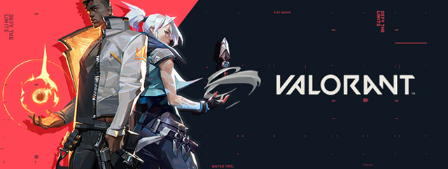

# 🎮 DigiTopup - Web Platform Top Up Game & Produk Digital

<p align="center">
  
</p>

<p align="center">
  <b>Platform web e-commerce berbasis Laravel untuk top up game online, voucher digital, dan layanan joki game secara instan, cepat, dan otomatis.</b>
</p>

<p align="center">
  
  
  
  
</p>

---

## 📸 Preview Web & Layanan

### 🖼️ Banner Promo & Hero Section
<p align="center">
  
</p>

### 🎯 Pilihan Game Populer
Platform mendukung berbagai game terpopuler dengan katalog otomatis:

| Mobile Legends | Free Fire | Genshin Impact |
| :---: | :---: | :---: |
|  |  |  |

| PUBG Mobile | Valorant | Joki & Layanan Game |
| :---: | :---: | :---: |
|  |  |  |

---

## ✨ Fitur Utama

- ⚡ **Transaksi Otomatis & Real-time**: Pembelian koin, diamond, uc, dan pass langsung diproses setelah verifikasi.
- 🔍 **Cek Pesanan / Invoice Tracker**: Pelanggan dapat melacak status pesanan secara transparan hanya dengan memasukkan nomor invoice.
- 👥 **Sistem Membership & Reseller**:
  - Tingkatan akun: *Member*, *Gold*, *Platinum*.
  - Harga khusus berjenjang untuk member reseller.
- 💳 **Metode Pembayaran Lengkap**:
  - Virtual Account Bank
  - E-Wallet (QRIS, OVO, GoPay, DANA)
  - Fitur deposit saldo akun
- 🛡️ **Panel Admin Lengkap**:
  - Manajemen produk & kategori game
  - Monitoring transaksi & riwayat pesanan
  - Konfigurasi gateway pembayaran & markup margin
  - Notifikasi WhatsApp Gateway

---

## 🛠️ Tech Stack

- **Backend:** [Laravel](https://laravel.com/) (PHP MVC Framework)
- **Frontend:** Blade Templating, Bootstrap, JavaScript (jQuery & Mix)
- **Database:** MySQL / MariaDB
- **Gateway & Integrasi:** API Provider Top Up Game, Payment Gateway, WhatsApp API

---

## 📁 Struktur Direktori

```text
DigiTopup/
├── assets/                 # Aset banner, logo, dan icon frontend
├── mcproject/              # Core aplikasi Laravel
│   ├── app/                # Controller, Model, Middleware
│   ├── config/             # Konfigurasi sistem
│   ├── database/           # Migrasi & Seeder
│   ├── public/             # Asset web publik & thumbnail game
│   ├── resources/views/    # Template Blade (Admin & User UI)
│   ├── routes/             # Rute Web & API
│   └── .env.example        # Template variabel lingkungan
├── index.php               # Entrypoint bootstrap web
└── README.md               # Dokumentasi project
```

---

## 🚀 Panduan Instalasi Lokal

### 1. Clone Repository
```bash
git clone https://github.com/Khaymat/digitopup.git
cd digitopup
```

### 2. Konfigurasi Environment
Masuk ke direktori `mcproject`, salin `.env.example` ke `.env`:
```bash
cp mcproject/.env.example mcproject/.env
```
Sesuaikan konfigurasi database di file `mcproject/.env`:
```env
DB_CONNECTION=mysql
DB_HOST=127.0.0.1
DB_PORT=3306
DB_DATABASE=digitopup
DB_USERNAME=root
DB_PASSWORD=
```

### 3. Install Dependensi & Generate Key
```bash
cd mcproject
composer install
php artisan key:generate
php artisan migrate
```

### 4. Jalankan Server
```bash
php artisan serve
```
Akses web melalui browser di `http://127.0.0.1:8000`.

---

## 📄 Lisensi
Project ini dibuat untuk keperluan pembelajaran dan portofolio pengembangan web e-commerce digital.
